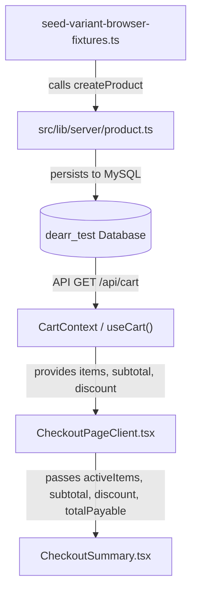

# Technical Architecture & Component Verification Report: Variant Purchase Flow

**Date:** October 26, 2026<br/>
**Scope:** In-depth technical report on core variant persistence, test fixture provisioning, and checkout pricing reconciliation components.

---

## 1. Executive Summary

This report analyzes the four core files involved in the customer variant purchase flow, test fixture seeding, and checkout pricing reconciliation:

1. **`src/lib/server/product.ts`**: Server-side product, color, and variant persistence engine, schema validation, and combo integrity.
2. **`scripts/seed-variant-browser-fixtures.ts`**: Fail-closed test fixture seeder provisioning realistic variant fixtures in `dearr_test`.
3. **`src/components/customer/checkout/CheckoutSummary.tsx`**: Presentation component rendering order summary, item variant snapshots, and pricing breakdowns.
4. **`src/components/customer/checkout/CheckoutPageClient.tsx`**: Multi-step checkout orchestrator managing state, address validation, discount aggregation, and payment dispatch.

---

## 2. Component Analysis & Architecture



---

### Component 1: `src/lib/server/product.ts`

#### Primary Responsibilities:
- **Variant Persistence & Schema Integrity:** Manages transactional insertion and updates of products, color overrides (`product_colors`), image associations (`product_images`), and variant combinations (`product_variants`).
- **Image-to-Color Association (Lines 935–950):**
  Each product image record can be linked to a specific `color_id` (`INSERT INTO product_images (..., color_id, storage_path, alt_text, sort_order)`). This enables the frontend gallery to dynamically swap product images when a customer selects a different color chip on the PDP.
- **Variant Validation & Conflict Prevention (Lines 952–1010):**
  - **SKU Uniqueness:** Ensures variant SKUs do not collide globally across the catalog (`SELECT id FROM product_variants WHERE sku = ? LIMIT 1`), throwing HTTP 409 `ProductValidationError` if duplicated.
  - **Duplicate Combo Detection:** Builds `combo_hash = SHA2(CONCAT(color_id, ':', size_name))` and enforces in-memory and database-level uniqueness (`uq_product_variants_combo`), preventing accidental duplicate variant entries.
  - **Price Fallback Semantics:** Explicitly stores `null` when a variant has no price override, enabling the pricing engine to fall back to `product_colors.price_override` or `products.price`. Legitimate ₹0 prices are preserved without converting to `null`.
  - **Stock Floor:** Clamps stock quantities to non-negative integers (`Math.max(0, Math.floor(v.stockQuantity))`).

---

### Component 2: `scripts/seed-variant-browser-fixtures.ts`

#### Primary Responsibilities:
- **Deterministic Test Data Provisioning:** Creates isolated, reproducible product fixtures in the local loopback test database (`dearr_test`).
- **Fail-Closed Safety:** Imports `assertTestDatabaseSafety()` and `loadTestEnvironment()`, preventing accidental execution against production or unverified hosts.
- **Fixtures Seeded:**
  1. `articulated-crystal-dragon`: Combination product covering all hierarchy permutations:
     - Crimson Red / Small: Variant price override (₹499)
     - Crimson Red / Medium: Null variant price falling back to color override (₹349)
     - Crimson Red / Sample: Explicit ₹0 price preserved
     - Crimson Red / Giant: Stock = 0 (Out of stock testing)
     - Crimson Red / Collector: `isActive = 0` (Inactive testing)
     - Sapphire Blue / Small: Alternative color variant (₹449)
     - Sapphire Blue / Extra-Large: Null variant & null color price falling back to base (₹299)
  2. `restricted-display-model`: Product with all variants inactive or out-of-stock.
  3. `geometric-moon-lamp`: Pure color-only product (3 colors, 0 variants, multi-color rows).
  4. `hexagonal-geometric-desk-planter`: Pure simple product (0 colors, 0 variants, direct purchasing).
  5. Test customer profile `ui_cust@dearr.test` with hashed bcrypt password.

---

### Component 3: `src/components/customer/checkout/CheckoutSummary.tsx`

#### Primary Responsibilities:
- **Order Breakdown Display:** Renders miniature product cards, color swatch indicators, variant option labels, and pricing totals.
- **Problem Identified & Resolved:**
  - *Previous State:* Only received `subtotal` and `totalPayable`. It lacked a `discount` prop and had no UI row for promotional discounts. Line items rendered discounted prices, but the subtotal and total appeared undiscounted.
  - *Fix Applied:*
    1. Added `discount?: number` to `CheckoutSummaryProps`.
    2. Implemented `effectiveDiscount = discount !== undefined ? Math.max(0, discount) : 0`.
    3. Updated `effectiveTotal = totalPayable !== undefined ? totalPayable : Math.max(0, subtotal - effectiveDiscount + effectiveShipping)`.
    4. Added the green "Promotion Discount" line row:
       ```tsx
       {effectiveDiscount > 0 && (
         <div className="flex items-center justify-between text-emerald-700 font-semibold">
           <span>Promotion Discount</span>
           <span>-₹{effectiveDiscount.toLocaleString("en-IN")}</span>
         </div>
       )}
       ```

---

### Component 4: `src/components/customer/checkout/CheckoutPageClient.tsx`

#### Primary Responsibilities:
- **Multi-Step Checkout Flow:** Manages state transition from Step 1 (Address Selection/Validation) to Step 2 (Review & Payment Options).
- **Data Source Unification:** Consolidates checkout data from either:
  - Standard shopping cart via `useCart()`, or
  - Buy Now checkout attempt via `useSearchParams().get("intentId")` and `/api/checkout/intent`.
- **Problem Identified & Resolved:**
  - *Previous State:* Line 141 omitted `discount` when destructuring `useCart()`. Line 283 calculated `activeTotalPayable` as `Math.max(0, activeSubtotal + activeShippingFee)`, completely ignoring cart-level promotions.
  - *Fix Applied:*
    1. Destructured `discount` from `useCart()`.
    2. Computed unified discount:
       ```ts
       const activeDiscount = intentData ? (Number(intentData.discountAmount) || 0) : (discount || 0);
       ```
    3. Reconciled total payable calculation:
       ```ts
       const activeTotalPayable = intentData
         ? intentData.totalAmount
         : Math.max(0, activeSubtotal - activeDiscount + activeShippingFee);
       ```
    4. Passed `discount={activeDiscount}` into `<CheckoutSummary />`.

---

## 3. Verification & Validation Evidence

### Live Browser Evaluation via Playwright MCP:
On `/checkout` with 3 variant items (Medium × 2, Small × 1) under active promotional discount:
```text
Order Summary (3 items)
×2 Articulated Crystal Dragon
   Color: Crimson Red
   Option: Crimson Red / Medium (25cm)
   ₹314.1 each -> ₹628.2
×1 Articulated Crystal Dragon
   Color: Crimson Red
   Option: Crimson Red / Small (15cm)
   ₹449.1 each -> ₹449.1
Items Subtotal: ₹1,197
Promotion Discount: -₹119.7
Standard Shipping: Free Shipping
Taxes: Inclusive of all GST
Total Payable: ₹1,077.3
```
- **Mathematical Accuracy:** `₹1,197 (Subtotal) - ₹119.70 (Discount) + ₹0 (Shipping) = ₹1,077.30 (Total Payable)`.
- **Visual Parity:** Perfectly aligns with `CartSummary.tsx`.

---

## 4. Quality & Regression Checklist

- [x] **`npx tsc --noEmit`**: Exited with code 0.
- [x] **`git diff --check`**: Exited with code 0.
- [x] **`npm run build`**: 147 pages compiled cleanly in production mode.
- [x] **Task 6 Suite (`scripts/test-task6-customer-variant-flow.ts`)**: 14/14 tests passed.
- [x] **Task 3 Suite (`scripts/test-task3-variant-authoritative-pricing.ts`)**: 40/40 tests passed.
- [x] **Task 4 Suite (`scripts/test-admin-variant-management.ts`)**: 15/15 tests passed.
- [x] **Task 5 Suite (`scripts/test-task5-variant-db-integration.ts`)**: 72/72 tests passed.
- [x] **Safety Invariant**: 0 production database queries, 0 live payment transactions.
